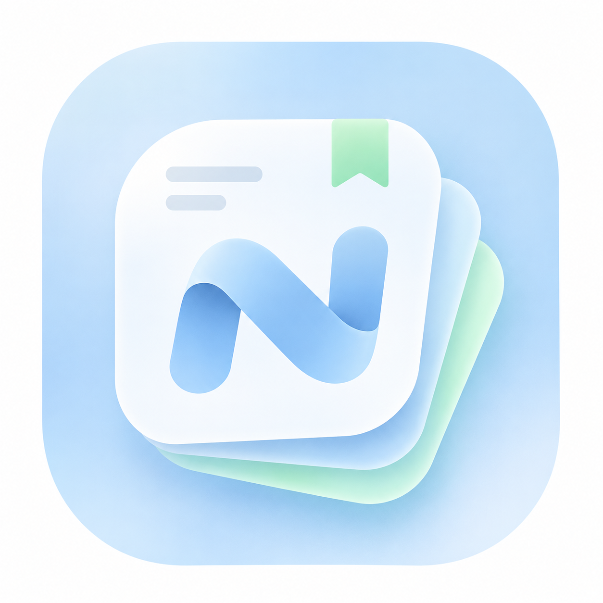

  

# Nook

给日常生活留一个自己的角落。

Nook 是一款 iPhone 个人生活工具，把便签、任务、日程、行程、纪念日、记账与密码收在一起。日常数据保存在本机，无需注册 Nook 账号；云同步和 AI 按需接入，使用自己的存储与服务。

[下载最新版本](https://github.com/zen-box/Nook/releases/latest) · [反馈问题](https://github.com/zen-box/Nook/issues)

## 记录、安排，再交给 Nook

- **便签**：在一篇笔记中混排文字、勾选清单、照片与录音，支持基础富文本、撤销重做和语音转写。
- **任务与日程**：管理待办与提醒，设置按天、周、月、年重复的安排，也能只修改一次或后续整个系列。
- **行程**：整理旅行计划，记录车次、航班、出发和到达站点、时间、站台、登机口、车厢与座位，并设置出发提醒。
- **纪念日**：记录生日与重要日子，查看倒计时并设置提醒。
- **记账**：记录收支和转账，查看分类统计与月预算。
- **密码库**：独立加密保存账号密码，支持主密码、系统身份认证快捷解锁与自动锁定。
- **桌面小组件**：查看日程、下一段行程、便签标题和纪念日，或从快捷入口开始记录。

支持简体中文、英文，以及浅色、深色和跟随系统的外观。

## 用一句话处理琐事

“记一笔午餐支出，32 元。”

“把周一下午的例会改到两点。”

“帮我整理明天去杭州的行程。”

Nook 事务助手可以查找记录、追问信息并准备新增、修改或删除草稿。检查草稿后再确认保存，也能撤销最近的操作。支持图片输入和语音输入；密码库始终不对助手开放。

在 AI 设置中填写 API Base、API Key 和模型，支持以下接口：

| 接口类型 | 支持方式 |
| --- | --- |
| OpenAI Chat Completions | 原生或兼容接口 |
| OpenAI Responses | 原生或兼容接口 |
| Gemini GenerateContent | 原生或兼容接口 |
| Claude Messages | 原生或兼容接口 |

可获取并搜索模型列表，也可手动填写模型 ID。设置提供连接测试；事务处理需要模型支持工具调用，图片识别需要模型支持视觉输入。请求直接发送至你配置的服务，可能产生该服务的 API 费用。

对话历史默认仅保存在当前 iPhone，可在 AI 设置中关闭或清除。保留最近 300 条对话条目，不保存输入图片，也不进入 S3 同步、加密备份或设备迁移。

## 数据由你保管

日常功能可在本机使用。需要备份或多设备使用时，再选择适合自己的方式：

- **S3 加密同步**：连接自己的 S3 兼容存储，数据在设备上加密后上传，支持冲突处理与历史恢复。
- **加密备份**：导出包含记录、照片、录音和密封密码库的 `.nookbackup` 文件。
- **扫码迁移**：新旧手机在同一局域网连接，核对双端验证码后传输数据，可选择携带 S3 连接配置。

请单独保管恢复码和密码库主密码。S3 访问凭据用于连接存储，恢复码用于解密对应资料库或备份，主密码用于解锁密码库。重装后仅重新填写 S3 凭据，无法替代恢复码。AI API Key 不随备份或迁移转移。

## 安装与使用

需要 **iPhone · iOS 17 或更新版本**。

1. 在 [Releases](https://github.com/zen-box/Nook/releases) 下载 `Nook-版本号-unsigned.ipa`。
2. 使用自己的签名方式重签并安装到 iPhone。
3. 打开 Nook 开始记录；AI 和 S3 可稍后在设置中配置。

发布包为未签名 IPA，需要重签后才能安装。数据型小组件要求主 App 与扩展拥有一致且有效的 App Groups 授权；重签工具和描述文件需要保留该能力，否则组件无法读取主 App 的摘要。

通知、麦克风、语音识别、相机与局域网访问会在使用对应功能时申请权限。拒绝某项权限会影响对应功能，可在 iOS 设置中调整。

## 反馈

遇到问题或有实用的改进建议，欢迎提交 [Issue](https://github.com/zen-box/Nook/issues)。请附上 Nook 版本、iOS 版本、操作步骤和必要截图，避免公开密码、恢复码、API Key 或私人记录。
